  
  
  
  
  <a href="https://www.kaggle.com/tejasgovind">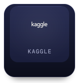</a>
  
  <a href="https://x.com/TejasGovin17982">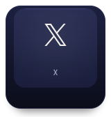</a>
  

 

<picture>
  <source media="(prefers-color-scheme: dark)" srcset="https://raw.githubusercontent.com/TejasGov/TejasGov/main/assets/titles/about-dark.svg" />
  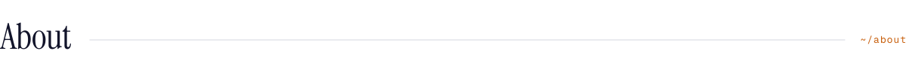
</picture>

I'm Tejas, a software engineer studying CS at the **University at Buffalo**, currently a **Software Engineering Intern at Daiwa Capital Markets America** and **co-founder of COA**, an agentic SaaS startup. I build across the stack, from React and Next.js interfaces to Node.js and FastAPI backends, and I've shipped four products you can use today in a browser.

**What I bring to a team**

- **I ship real software.** Two browser games built on Three.js and WebGL, a clinical AI scribe and an AI tutor, all deployed and live. One of them has a 114-test suite behind it.
- **I work on AI that does real work.** Speech-to-text and BioNLP pipelines for doctors, Socratic tutoring for CS students, and agentic workflows at COA.
- **I care how it feels.** Real-time 3D, motion and detailed UI are where I do my best work, and this profile is made the same way.
- **I've worked well beyond code.** Research on VR and moral decisions, data analysis in SQL and Tableau, and leadership roles reaching 800+ students at UB.

Off the keyboard I'm into football, hip-hop and chess, which all come down to small details done well.

> **Open to:** software engineering, full-stack and applied-ML roles. The fastest way to reach me is [email](mailto:tejasgov2005@gmail.com) or [LinkedIn](https://www.linkedin.com/in/tejas-govind-29520a2b2/).

 

<picture>
  <source media="(prefers-color-scheme: dark)" srcset="https://raw.githubusercontent.com/TejasGov/TejasGov/main/assets/titles/experience-dark.svg" />
  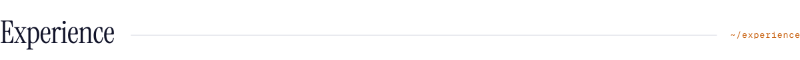
</picture>

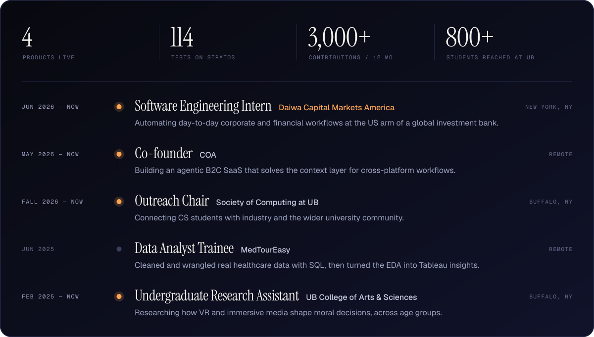

 
 

<picture>
  <source media="(prefers-color-scheme: dark)" srcset="https://raw.githubusercontent.com/TejasGov/TejasGov/main/assets/titles/work-dark.svg" />
  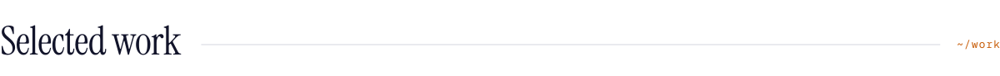
</picture>

  <a href="https://github.com/TejasGov/Stratos"></a>
  <a href="https://github.com/TejasGov/Yudhveer"></a>

  <a href="https://github.com/TejasGov/echoscribe"></a>
  <a href="https://github.com/TejasGov/Socra_MVP">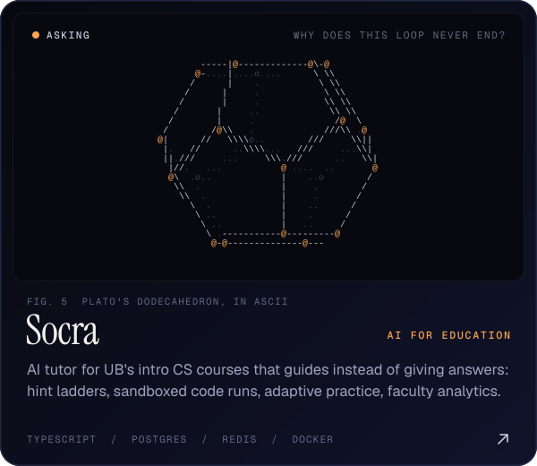</a>

  
    All four are live. Try them&nbsp;&nbsp;·&nbsp;&nbsp;<a href="https://stratos-eosin.vercel.app">Stratos</a>&nbsp;&nbsp;·&nbsp;&nbsp;<a href="https://yudhveer.pages.dev/">Yudhveer</a>&nbsp;&nbsp;·&nbsp;&nbsp;<a href="https://echoscribe.vercel.app/">EchoScribe</a>&nbsp;&nbsp;·&nbsp;&nbsp;<a href="https://socra-mvp.vercel.app/">Socra</a>
  

 

<picture>
  <source media="(prefers-color-scheme: dark)" srcset="https://raw.githubusercontent.com/TejasGov/TejasGov/main/assets/titles/toolkit-dark.svg" />
  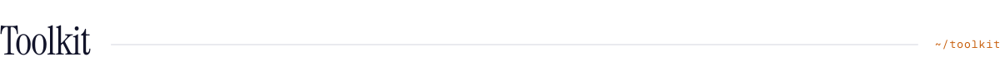
</picture>

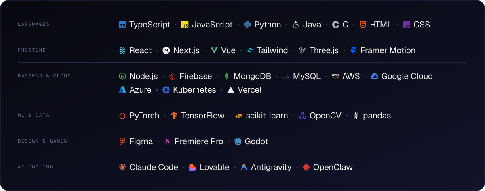

 
 

<picture>
  <source media="(prefers-color-scheme: dark)" srcset="https://raw.githubusercontent.com/TejasGov/TejasGov/main/assets/titles/activity-dark.svg" />
  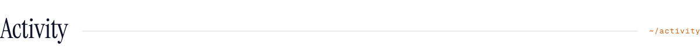
</picture>


 
 

