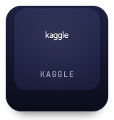
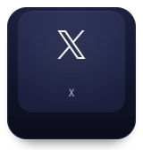
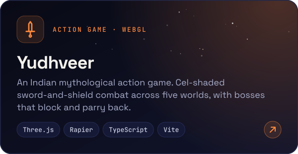
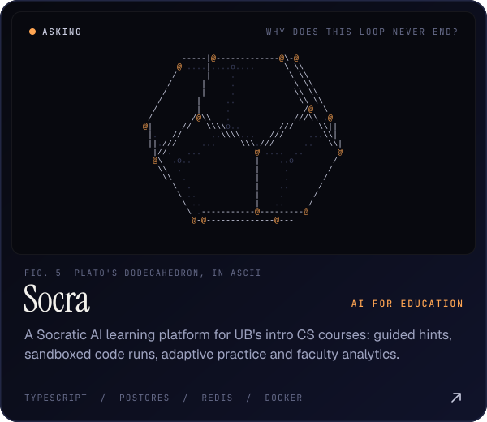
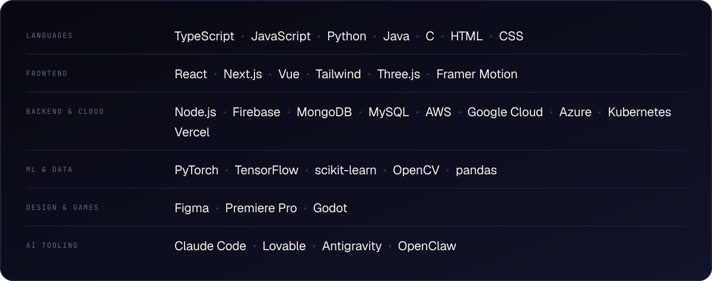

  
  
  
  
  
  
  
  

 

<picture>
  <source media="(prefers-color-scheme: dark)" srcset="https://raw.githubusercontent.com/TejasGov/TejasGov/main/assets/titles/about-dark.svg" />
  
</picture>

I'm Tejas, a CS student at the **University at Buffalo** who likes building things that feel as good as they work. I work across the stack, from clean interfaces in React and Next.js to Node.js backends, APIs and data-driven features, and I care about product thinking, user experience, and turning rough ideas into polished experiences.

I'm drawn to the places where engineering meets creativity: browser games, real-time features, machine-learning experiments, and UI that makes an experience feel special. Outside of code I'm into design, games and content creation, and I like building and learning in public across GitHub, YouTube, Kaggle and my blog.

> **Right now:** becoming a stronger builder, going deeper technically, and shipping projects that are practical, polished and worth showing off.

 

<picture>
  <source media="(prefers-color-scheme: dark)" srcset="https://raw.githubusercontent.com/TejasGov/TejasGov/main/assets/titles/work-dark.svg" />
  
</picture>

  
  

  
  

  
    Try them live&nbsp;&nbsp;·&nbsp;&nbsp;<a href="https://stratos-eosin.vercel.app">Stratos</a>&nbsp;&nbsp;·&nbsp;&nbsp;<a href="https://yudhveer.pages.dev/">Yudhveer</a>&nbsp;&nbsp;·&nbsp;&nbsp;<a href="https://myecho-scriber.lovable.app/">EchoScribe</a>&nbsp;&nbsp;·&nbsp;&nbsp;<a href="https://socra-three.vercel.app">Socra</a>
  

 

<picture>
  <source media="(prefers-color-scheme: dark)" srcset="https://raw.githubusercontent.com/TejasGov/TejasGov/main/assets/titles/toolkit-dark.svg" />
  
</picture>

 
 

<picture>
  <source media="(prefers-color-scheme: dark)" srcset="https://raw.githubusercontent.com/TejasGov/TejasGov/main/assets/titles/activity-dark.svg" />
  
</picture>

 
 

